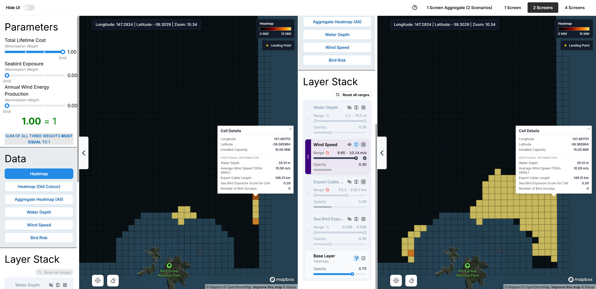
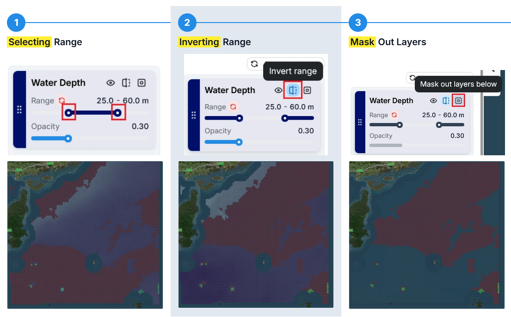

<div align="center">

# VIC Offshore Wind Farm Map Tool

<table align="center">
  <tr>
    <td>
      
    </td>
    <td>
      
    </td>
  </tr>
</table>


A MOO (Multi-Objective Optimisation) visual planning tool, built around helping stakeholders explore and compare
trade-offs between cost, energy production and seabird impact.

Optimisation model is through contributions of others as part of a [wider Monash research project](https://www.monash.edu/it/environmental-informatics-hub/projects/bird-sensitive-wind-farm-planning).

</div>

---

## Table of Contents

- [Prerequisites](#prerequisites)
- [Getting Started](#getting-started)
  - [Tool](#tool)
  - [Heatmap Generation](#heatmap-generation)
- [Built With](#built-with)

---

## Prerequisites

Make sure the following are installed on your machine before you begin.

| Requirement | Recommended Version | Notes |
| --- | --- | --- |
| [Node.js](https://nodejs.org/) | 18.x or later | Includes npm by default |
| npm | 9.x or later | Ships with Node.js |

Verify your installation:

```sh
node -v
npm -v
```

---

## Getting Started

The repository contains two parts: the front-end mapping **tool**, and the **heatmap generation script** used to prepare data for it.

<br>

### Tool

Run the map front end locally.

```sh
cd map_frontend
npm i
npm run dev
```

Once the dev server starts, open the URL printed in your terminal (typically `http://localhost:5173`) in your browser.

<br>

### Heatmap Generation

Generate heatmap data from an optimisation results CSV.

```sh
cd heatmap_creation_script
npm i
node optimisation_results_preprocessing.js <INSERT CSV FILE>
```

Replace `<INSERT CSV FILE>` with the path to your optimisation results file, for example:

```sh
node optimisation_results_preprocessing.js ./data/optimisation_results.csv
```

---

## Built With

[![React][React.js]][React-url]
[![Mapbox GL JS][Mapbox]][Mapbox-url]
[![Mantine][Mantine]][Mantine-url]
[![Turf.js][Turf]][Turf-url]

---

<!-- MARKDOWN LINKS & IMAGES -->
[React.js]: https://img.shields.io/badge/React-20232A?style=for-the-badge&logo=react&logoColor=61DAFB
[React-url]: https://react.dev/
[Mapbox]: https://img.shields.io/badge/Mapbox%20GL%20JS-000000?style=for-the-badge&logo=mapbox&logoColor=white
[Mapbox-url]: https://docs.mapbox.com/mapbox-gl-js/
[Mantine]: https://img.shields.io/badge/Mantine%20UI-339AF0?style=for-the-badge&logo=mantine&logoColor=white
[Mantine-url]: https://mantine.dev/
[Turf]: https://img.shields.io/badge/turf.js-1E4620?style=for-the-badge&logo=javascript&logoColor=F7DF1E
[Turf-url]: https://turfjs.org/
